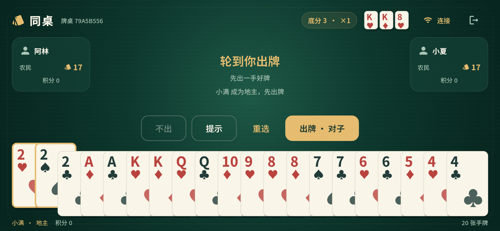
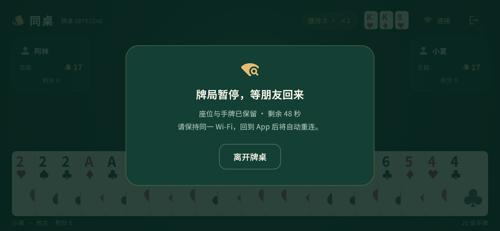
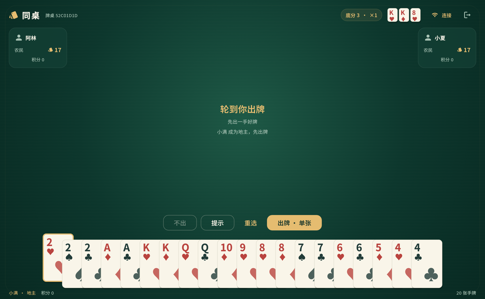

# Landlord LAN · 同桌斗地主

三台设备，一张牌桌。**Windows / iOS / Android 共用 Flutter 项目，通过同一 Wi-Fi 或热点联机，游戏不需要互联网。**




## 下载安装

- [下载 Windows x64 免安装版](https://github.com/Ginchanging/landlord-lan/releases/download/v0.2.0/landlord-lan-v0.2.0-windows-x64.zip)：Windows 10 1903 或更高 / Windows 11。**完整解压后双击 `LandlordLAN.exe`**，保留旁边的 DLL 和 `data` 文件夹；包内附带 C++ 运行库。
- [下载 Android APK](https://github.com/Ginchanging/landlord-lan/releases/tag/v0.2.0)：Android 7.0 / API 24 及以上，包含 ARM32、ARM64、x86_64。
- iPhone / iPad：最低 iOS 15，源码位于 `ios/`。需要 Mac + Xcode 签名安装，见 [iOS 构建说明](docs/BUILD.md#ios)。没有提供已签名 IPA 或 TestFlight 分发。使用 Xcode 27 时请取最新 `main` 源码，`v0.1.0` 归档仍使用旧的 iOS 14 配置。
- APK 是用于侧载试玩的 **Release 构建、调试密钥签名**。各平台发布文件及 SHA-256 校验值放在 GitHub Release，密钥不进入仓库。不同构建机器的调试签名可能不同，更新失败时需要先卸载旧测试版。

## 和朋友开一局

1. 三台电脑或手机连接同一个 Wi-Fi / 局域网，或让一部手机开启热点、其他设备加入。Windows 电脑算一名玩家，可与 iPhone、Android 混合联机。
2. 一人填写昵称，点 **创建牌桌**。
3. 其他人在 **附近的牌桌** 点击加入。搜索不到时，房主点右上角 **连接**，其他人输入显示的 `IP:端口`。
4. 三人点 **准备**，自动发牌。依次叫 1～3 分，地主先出牌。
5. 点击手牌选中，再点 **出牌**；**提示** 轮换合法组合，**重选** 清除选择。

Windows v0.2.0 沿用通信协议 v1，可与 v0.1.0 手机端连接，无需为了加入电脑端重新安装手机 App。

Wi-Fi 路由器可以没有外网；不使用账户、云服务器、广告、分析 SDK 或远程字体。`INTERNET` 是 Android 创建本地网络 Socket 所需的权限，不代表游戏需要外网。首版只支持三位真人。

### 断线、后台和房主

- 游戏开始后任意玩家断线，暂停并保留座位、手牌和轮次 **60 秒**，回到 App 后自动重连。
- 后续玩家断线不会延长已经开始的等待时间；全部恢复后继续。
- 超时或有人主动离开，本局结束且不计分；房主退出关闭整个房间。
- Windows 可以切换窗口或最小化继续联机；电脑睡眠、关闭游戏会中断连接。
- 手机在 App 前台保持亮屏；切换后台可能被系统暂停。房主进程被系统终止后无法恢复，不做房主迁移。
- 积分保存在当前房间内，关闭房间后清空，不涉及真钱。



### 搜索不到 / 无法加入

- iOS：在系统设置中允许本 App 访问 **本地网络**。拒绝权限会影响自动发现及连接。
- Android：确认 Wi-Fi/热点连接仍在；检查是否有阻止局域网访问的 VPN。
- Windows：在可信的家庭 Wi-Fi / 热点下，把网络配置文件设为**专用网络**，并允许 Landlord LAN 通过 Windows 防火墙访问专用网络。自动搜索失败时可用 IP:端口加入；无需关闭整个防火墙。
- 酒店、访客 Wi-Fi 可能开启 **AP / 客户端隔离**，同网设备也不能互相访问；更换普通 Wi-Fi 或热点。
- 自动发现依赖 Bonjour / mDNS。路由器屏蔽它时可尝试手动地址，但客户端隔离无法靠手动地址解决。
- 热点行为取决于系统和运营商。有些手机需先打开移动数据才能启用热点；游戏通信仍只在局域网内。无需外网的路由器是更稳定的选择。
- 多个地址中选择与其他手机同一网段的地址；不要让朋友连接 `127.0.0.1`。

## 规则与实现

支持单张、对子、三张、三带一、三带一对、顺子、连对、飞机及带翅膀、四带二、四带两对、炸弹、王炸。采用叫分制，全员不叫则重发；炸弹、王炸、春天或反春天翻倍。翅膀和计分约定见 [规则](docs/RULES.md)。

房主设备运行本地 WebSocket 服务并统一校验操作。普通客户端仅获得自己的手牌、各玩家剩余张数与公开牌面。适合朋友间的可信局域网，房主设备持有整副牌局状态。

- `lib/core/`：纯 Dart 牌型、提示、牌局状态和计分。
- `lib/network/`：房主服务、客户端心跳与重连、Bonjour / Android NSD。
- `lib/ui/`：绿色牌桌、手牌、手机横屏和 Windows 鼠标操作界面。
- [通信协议](docs/PROTOCOL.md) · [构建说明](docs/BUILD.md) · [验证记录](docs/TESTING.md)

## 开发

固定 **Flutter 3.41.9 / Dart 3.11.5**，提交了 `pubspec.lock`。Android SDK 36、Build Tools 35.0.0（AGP 默认）、NDK 28.2.13676358、JDK 17；iOS 构建需要 macOS、Xcode、CocoaPods；Windows x64 构建需要 Windows 和 Visual Studio 2022 的“使用 C++ 的桌面开发”工作负载。

```sh
flutter pub get
flutter analyze
flutter test --reporter expanded
flutter run
flutter build apk --release
```

APK 输出到 `build/app/outputs/flutter-apk/app-release.apk`。首次安装开发工具或下载依赖需要互联网，**安装后的游戏不需要**。GitHub Actions 检查代码、运行测试、构建 Android APK，在 macOS 上执行 iOS 无签名编译，并在 Windows 上运行测试、构建和启动解压后的免安装包。

截图来自 Flutter 组件渲染，不能替代跨设备局域网联机验证。第三方声明见 [THIRD_PARTY_NOTICES.md](THIRD_PARTY_NOTICES.md)。


